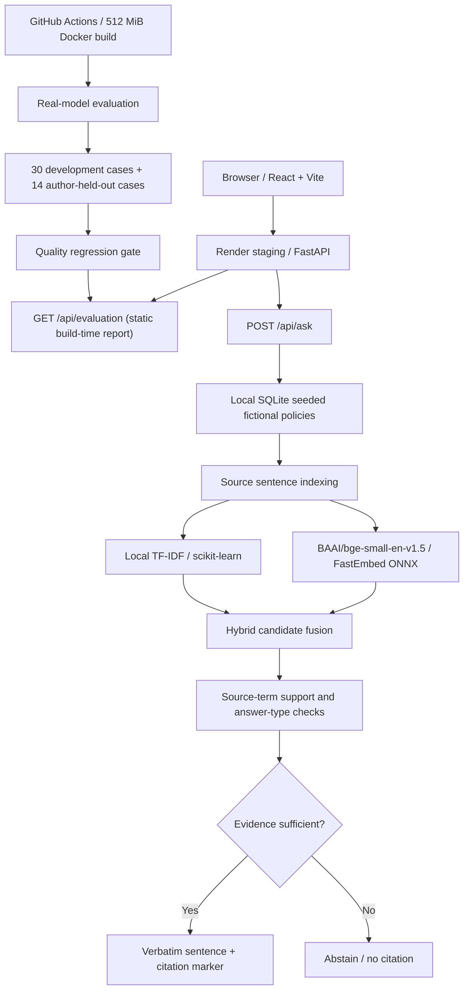

# EvidenceDesk-AI architecture

**Scope:** technical architecture of the `staging-fastembed` experiment. Public production runs separately from `main`, with TF-IDF by default.

## Why this design?

- **Retrieval:** Real BGE-small sentence embeddings capture approximate meaning; normalized TF-IDF contributes exact-match evidence. Candidate fusion and light reranking use both without paid APIs.
- **Answering:** Answers are verbatim sentences, not LLM-generated paraphrases. Source IDs and passage text are returned for manual verification. Evidence gates are heuristics, not formal entailment guarantees.
- **Measurement:** The evaluation JSON is produced during the staging container build, not on web requests. Metrics include hit@1, Recall@3, MRR, answer-fragment matching, abstention accuracy, and warm per-query latency.
- **Runtime:** One Uvicorn worker, ephemeral SQLite, preloaded ONNX model, no public uploads and no paid generation. CI tests a single container under a 512 MiB cap; this is not a concurrency SLA.
- **Privacy/security:** Four deliberately fictional documents only. Do not ingest customer, secret, financial, or regulated data into the public demo.
- **Isolation:** `render.staging.yaml` and `Dockerfile.staging` belong to the staging branch; do not merge or deploy to `main` without explicit approval.

## System boundaries and trade-offs

This is a recruiter portfolio **demonstration**, not an enterprise production RAG platform. Uploaded PDFs require extractable text; no OCR, production RBAC, tenant isolation, durable vector index, or verified NLI entailment is implemented. Similarity scores are not calibrated correctness probabilities. The 14-question held-out set uses different questions but the *same fictional documents* and has already been inspected during development, so it is a **development holdout**, not an independent generalization claim.

See [evaluation method](EVALUATION.md), [staging deployment guide](STAGING.md), and [demo walkthrough](DEMO.md).
