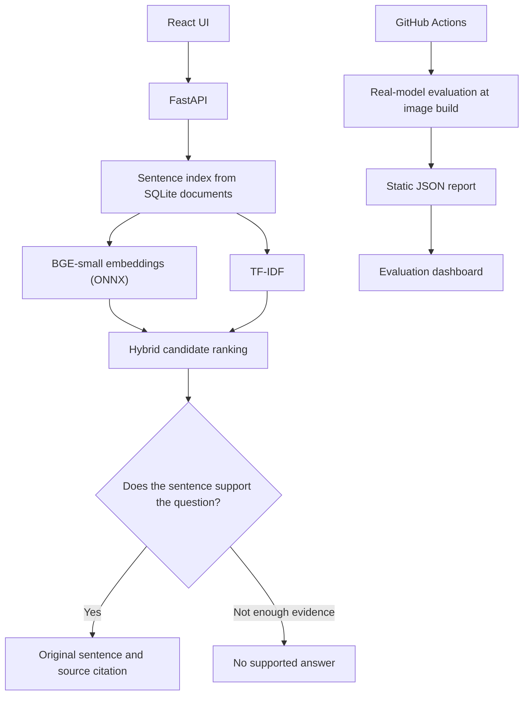

# How EvidenceDesk works

The staging app is deliberately small. A React frontend talks to FastAPI, which keeps the sample document records in SQLite and searches an in-memory index of their sentences. There is no separate vector database or hosted AI service.

## Why two search methods?

Keyword matching was a good starting point, but a question like “Where should live system passwords be saved?” uses different words from the sentence about storing production credentials. Sentence embeddings help connect those ideas.

Embeddings alone weren't enough, though. A policy can sound similar to a question without answering it. I kept TF-IDF as a second signal and added source-support checks before returning a citation.

The verifier still uses heuristics, including lexical agreement, expected answer type, and local similarity scores. It's not an entailment model. For that reason, the answer is always quoted from the source sentence rather than rewritten into a new claim.

## Request flow

1. FastAPI accepts a question at `POST /api/ask`.
2. BGE-small (through FastEmbed/ONNX) and local TF-IDF retrieve potential source sentences.
3. The candidate list is combined and reranked. Weak or unsupported matches are filtered.
4. The strongest surviving sentence is returned with its document title and citation. If none survive, the app abstains.

The in-memory indexes are rebuilt at startup and when documents change. They're not persisted as a vector store.

## The evaluation page

Instead of computing evaluation metrics whenever someone opens the dashboard, the staging Docker build runs the labeled questions once using the real model and writes a JSON report. FastAPI serves that report through `GET /api/evaluation`.

The build also checks a few minimum quality thresholds, and CI runs the container with a 512 MiB memory limit. That is a startup and functional smoke test, not a guarantee about heavy traffic or Render cold starts.

## Deployment boundaries

The semantic app lives on the `staging-fastembed` branch and a separate Render staging service. The `main` branch still runs the simpler TF-IDF deployment. Paid LLM and embedding APIs are disabled in staging, and anonymous document uploads are blocked.

The four demonstration policies are fictional. The current system has no multi-user access control, durable vector storage, OCR, audit trail, or independently validated factual entailment. I would address those before treating it as a production document platform.

More detail: [evaluation](EVALUATION.md) · [staging setup](STAGING.md) · [demo](DEMO.md).
