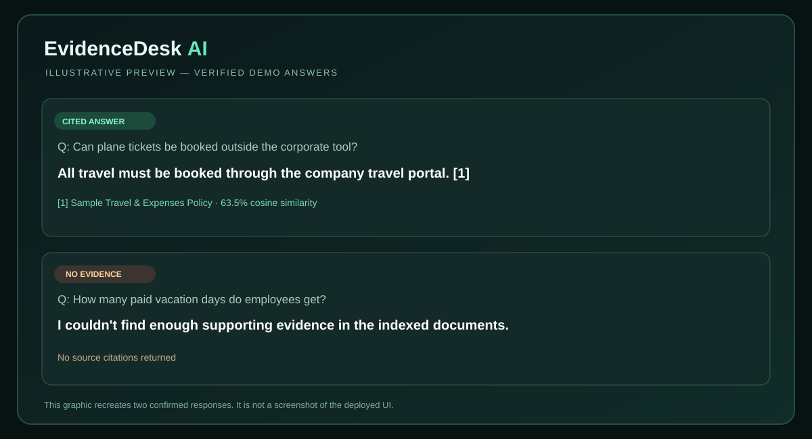
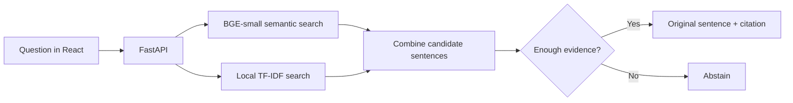

# EvidenceDesk AI

**A document-search app that shows its sources—and says when it doesn't know.**

[Try the semantic demo](https://evidencedesk-ai-staging-bge.onrender.com) · [See the evaluation dashboard](https://evidencedesk-ai-staging-bge.onrender.com) · [View the simpler TF-IDF version](https://evidencedesk-ai.onrender.com)

[](https://github.com/charithreddy9/EvidenceDesk-AI/actions/workflows/ci.yml?query=branch%3Astaging-fastembed)
[](https://github.com/charithreddy9/EvidenceDesk-AI/actions/workflows/staging-memory.yml?query=branch%3Astaging-fastembed)

*React · TypeScript-free JavaScript · Vite · FastAPI · Python · SQLite · BGE-small / FastEmbed · scikit-learn · Docker · GitHub Actions · Render*

## Why I built it

I wanted to explore a problem that comes up quickly with document-based AI: finding a passage that sounds related to a question is not the same as finding a passage that answers it.

EvidenceDesk started with straightforward keyword search. That was a useful baseline, but it struggled when someone asked a question in different words from the document. I added local sentence embeddings to handle paraphrases, then ran into the opposite problem: semantic search occasionally returned convincing-looking passages that had nothing to do with the actual answer.

The current staging version combines both approaches. It searches with BGE-small embeddings and TF-IDF, checks the candidate sentences for relevant evidence, and either returns the original sentence with a citation or says it couldn't find enough support. It **doesn't use a language model to write the answer**.

All four documents in the public demo are fictional policies. They're intentionally small so it's easy to inspect the result and notice when the retrieval goes wrong.

## See it in action



*Illustrative examples based on verified outputs—not direct screenshots of the live app. The interactive demo is linked above.*

Try asking:

> **Can plane tickets be booked outside the corporate tool?**

The response quotes the travel policy:

> All travel must be booked through the company travel portal. [1]

The citation shows the policy title and exact sentence. You can also ask where live-system passwords should be stored. The answer points to the credentials rule in the security handbook.

Then try something the documents don't cover:

> **How many paid vacation days do employees get?**

Rather than guess, the app returns:

> I couldn't find enough supporting evidence in the indexed documents.

That's the behavior I was most interested in getting right: a missing answer should look like a missing answer.

**[Open the working semantic demo](https://evidencedesk-ai-staging-bge.onrender.com)**

## How it works



The backend stores document records in SQLite and builds an in-memory sentence index. BGE-small runs locally through ONNX; TF-IDF provides a second signal for terms that matter. A lightweight verifier examines the top candidate sentences before the API returns anything to the user.

I chose verbatim sentences over generated summaries so the app wouldn't need a paid API, and so people could verify the answer against the source. The trade-off is that a single sentence sometimes can't fully answer a complicated question.

The [architecture notes](https://github.com/charithreddy9/EvidenceDesk-AI/blob/staging-fastembed/ARCHITECTURE.md) explain the components, ranking trade-offs, and why the staging service is separate from production.

## What testing changed

I didn't get answer filtering right on the first try. An early semantic-only version found the meal allowance correctly but also surfaced unrelated policies. Tightening the filters improved abstention, but it rejected legitimate paraphrases, including questions about booking channels and credential storage.

I added an evaluation page so those mistakes wouldn't be invisible. It shows the individual questions, the expected document, the retrieved sentence, and whether the case passed. Failures stay visible instead of being averaged away.

The most recent *verified development run* gave:

| Check | Result |
| --- | ---: |
| Original development set | **30 / 30** cases passed |
| Unsupported questions in that set | **8 / 8** correctly rejected |
| Separate development question set | **13 / 14** cases passed |
| Unsupported questions in the second set | **6 / 6** correctly rejected |

Those numbers need context. The original set has 30 hand-written questions over four fictional documents. The other 14 questions use different wording but **the same documents**, and I inspected them while improving the verifier. This is a useful regression test, **not** an independent benchmark or a claim of 100% accuracy in the real world.

The dashboard also reports Recall@3, mean reciprocal rank (MRR), and warm retrieval latency. Similarity values are embedding scores, not probabilities that an answer is correct.

Read the [evaluation notes](https://github.com/charithreddy9/EvidenceDesk-AI/blob/staging-fastembed/EVALUATION.md) to reproduce the report and see precisely what each metric means.

## Run it locally

The hybrid search code lives on `staging-fastembed`, not on this default branch. Check out that branch before trying the commands below:

```bash
git clone https://github.com/charithreddy9/EvidenceDesk-AI.git
cd EvidenceDesk-AI
git switch staging-fastembed
```

You need Python 3.11+, Node.js 22+, and internet access the first time the BGE model downloads.

```bash
python -m venv .venv
source .venv/bin/activate
pip install -r backend/requirements-fastembed.txt
RETRIEVAL_BACKEND=fastembed uvicorn backend.app:app --port 8000
```

In a second terminal:

```bash
cd frontend
npm install
# Put VITE_API_BASE_URL=http://localhost:8000 in frontend/.env.local
npm run dev
```

On Windows, activate the virtual environment with `.venv\Scripts\Activate.ps1` in PowerShell and set the backend environment variable using `$env:RETRIEVAL_BACKEND="fastembed"`.

To run the checks and create a fresh evaluation report:

```bash
pip install -r backend/requirements-dev.txt
python -m pytest backend/tests -q
RETRIEVAL_BACKEND=fastembed python -m backend.evaluate --report /tmp/evidencedesk-evaluation.json
python -m backend.quality_gate /tmp/evidencedesk-evaluation.json
```

CI also builds a staging Docker image, runs the actual BGE model, and checks that the service starts within a **512 MiB memory limit**. This only checks a small workload, not concurrency or production-scale load.

## What I would improve next

I'd test against a genuinely unseen collection of documents with someone else labeling the answers. I also want to check multi-sentence questions, improve the evidence verifier beyond word overlap, and test memory and latency under concurrent requests. Before using real organizational documents, the app would need stronger authentication, audit logging, persistent storage, and safer ingestion.

This is a working **portfolio prototype**, not a secure multi-tenant document platform. Don't upload confidential or regulated information to the public demo.

## Project notes

- [Architecture and engineering decisions](https://github.com/charithreddy9/EvidenceDesk-AI/blob/staging-fastembed/ARCHITECTURE.md)
- [How the evaluation works](https://github.com/charithreddy9/EvidenceDesk-AI/blob/staging-fastembed/EVALUATION.md)
- [Three-minute demo walkthrough](https://github.com/charithreddy9/EvidenceDesk-AI/blob/staging-fastembed/DEMO.md)
- [Staging deployment and memory limits](https://github.com/charithreddy9/EvidenceDesk-AI/blob/staging-fastembed/STAGING.md)
- [Standard deployment instructions](DEPLOY.md)

**Repository landing page:** This README describes the latest *staging* implementation, not the production code on `main`. Follow the staging branch links above for its source code.

**About the two deployed versions:** the public production URL is built from `main` and uses TF-IDF by default. The hybrid BGE version, evaluation dashboard, and documentation here are maintained on `staging-fastembed`. The staging service is deployed manually; GitHub may be ahead of the live demo. Paid AI calls and anonymous uploads are disabled on staging.
