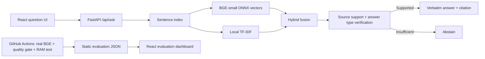

# EvidenceDesk-AI
### Evidence-first document question answering · Full-stack AI engineering portfolio

[**Try the semantic staging demo**](https://evidencedesk-ai-staging-bge.onrender.com) · [**Evaluation dashboard**](https://evidencedesk-ai-staging-bge.onrender.com) · [**Production TF-IDF demo**](https://evidencedesk-ai.onrender.com)

[](https://github.com/charithreddy9/EvidenceDesk-AI/actions/workflows/ci.yml?query=branch%3Astaging-fastembed)
[](https://github.com/charithreddy9/EvidenceDesk-AI/actions/workflows/staging-memory.yml?query=branch%3Astaging-fastembed)

**Built with:** React 19 · Vite · Python 3.11 · FastAPI · BAAI/bge-small-en-v1.5 · FastEmbed/ONNX · scikit-learn TF-IDF · SQLite · Docker · GitHub Actions · Render

> **Deployment status:** The public production website runs from the separate `main` branch with its default lexical TF-IDF retrieval. The semantic/hybrid implementation and evaluation work live on `staging-fastembed` and use a separate Render service with manual deployment. GitHub code may be ahead of the staging URL. Do not confuse the two versions.

## What it does

EvidenceDesk answers questions about sample policy documents using **a local semantic + lexical search pipeline**. It retrieves source sentences, applies a lightweight evidence verifier, and returns a short **verbatim cited answer**. If no candidate passes verification, it abstains instead of inventing an answer. A read-only evaluation dashboard makes both successes and failures inspectable.

**Example question:** “How much can I spend per day on meals?”

**Source-grounded answer:** “The meal allowance is $65 per day. [1]” — from a *fictional* travel policy. No paid LLM is involved.

### Product demonstration
- **Ask workspace:** Search the four seeded fictional policies and inspect specific cited sentences, titles, and cosine similarity scores.
- **Source-aware abstention:** Unsupported queries should return an explicit no-evidence response without citations.
- **Evaluation lab:** View Hit@1, Recall@3, MRR, abstention accuracy, approximate warm latency, source-fragment matches, and before/after comparisons. Filter all test cases, including failures.
- **Local-first embeddings:** BGE-small runs through ONNX on CPU, without uploading document contents to a hosted embedding provider.
- **Staging guardrails:** 512 MiB container smoke gate; precomputed evaluation snapshots; publicly disabled document mutation and paid generation; production branch unchanged.

## System design



See [**ARCHITECTURE.md**](ARCHITECTURE.md) for implementation details and trade-offs.

## Evidence-driven testing

The staging image builds a **real-model evaluation report** on 30 manually labeled development questions (12 direct, 10 paraphrases, 8 unanswerable) and a 14-question *development holdout*. Each has expected source labels; answerable cases have verbatim answer fragments.

The Docker build fails when the quality regression gate is not satisfied. Results are **not** a statistically representative benchmark, calibrated confidence, or independent proof of entailment. The 14 held-out questions were inspected during development and share the same fictional documents.

| What is measured | Definition |
| --- | --- |
| Hit@1 / Recall@3 | Expected document present at rank one / within top three retained citations |
| MRR | Mean reciprocal rank of the expected source |
| Abstention accuracy | Unsupported questions correctly answered with no citations |
| Verbatim support | Selected source sentence contains labeled source fragment, not a model-graded factual judgment |
| Mean / P95 latency | Warm, single-process retrieval + filtering during image build; excludes browser/network/cold starts |

See [**EVALUATION.md**](EVALUATION.md) for reproducible commands, dataset caveats, and score interpretation. The dashboard is a build-time snapshot, not continuously gathered traffic telemetry.

## Run locally

### Fast semantic and hybrid mode
Requires Python 3.11+, Node.js 22+, and a first-run download of the open model weights.

```bash
python -m venv .venv
# macOS/Linux
source .venv/bin/activate
# Windows PowerShell: .venv\\Scripts\\Activate.ps1
pip install -r backend/requirements-fastembed.txt
RETRIEVAL_BACKEND=fastembed uvicorn backend.app:app --port 8000
```

In another terminal:

```bash
cd frontend
npm install
# Set VITE_API_BASE_URL=http://localhost:8000 in frontend/.env.local
npm run dev
```

The production default is `tfidf` unless `RETRIEVAL_BACKEND=fastembed` is configured. The staging Docker setup builds the frontend and API into one service.

### Run evaluation and tests

```bash
pip install -r backend/requirements-dev.txt
python -m pytest backend/tests -q
RETRIEVAL_BACKEND=fastembed python -m backend.evaluate --report /tmp/evidencedesk-evaluation.json
python -m backend.quality_gate /tmp/evidencedesk-evaluation.json
cd frontend && npm run build
```

Staging CI additionally builds `Dockerfile.staging`, runs the real local BGE model, tests the API with a **512 MiB memory cap**, and blocks image builds when its labeled-data quality requirements are missed. It does not benchmark sustained concurrency.

## Key endpoints

| Endpoint | Behavior |
| --- | --- |
| `GET /api/health` | Health, retriever and indexed document count |
| `GET /api/config` | Enabled capabilities |
| `GET /api/documents` | Source library |
| `POST /api/ask` | Ranked evidence and source-cited extracted sentence or abstention |
| `GET /api/evaluation` | Read-only, Docker-build-time evaluation snapshot in staging |
| `POST /api/upload` | PDF/TXT/MD ingestion; **disabled for anonymous public staging** |

## Video and screenshots

Follow [**DEMO.md**](DEMO.md) for a three-minute walkthrough and a screenshot capture checklist. Screenshots and recordings are intentionally not represented as captured until verified from the live deployment.

## Security, limitations and roadmap

**Public staging:** `ENABLE_PAID_LLM=false`, `ENABLE_PAID_EMBEDDINGS=false`, `ALLOW_PUBLIC_UPLOAD=false`. No OpenAI key or anonymous writes are needed. Staging auto-deploy remains **off**.

- All four policies are **fictional**. Never upload regulated, proprietary, or confidential data to the demo.
- This is source **extraction**, not generative LLM synthesis. Lexical support is heuristic; no formal entailment, claim verification, or calibrated confidence.
- Memory measurements show a single small instance, not a stress-tested SLA. Render free tier may cold-start.
- PDFs require text extraction; OCR, malware scanning, per-user RBAC, multi-tenant isolation, persistent vector storage, and production audit logging are not provided.
- The manually authored evaluation is not representative of external documents. The next milestone is a truly unseen labeled document suite and human-reviewed answer faithfulness.

**Engineering documentation:** [Architecture](ARCHITECTURE.md) · [Evaluation](EVALUATION.md) · [Staging deployment](STAGING.md) · [Demo walkthrough](DEMO.md) · [Standard deployment](DEPLOY.md).

---

Built as an educational engineering portfolio project demonstrating **retrieval systems, grounded answers, offline model inference, full-stack APIs, continuous evaluation, containerization, and safe deployment isolation**.
